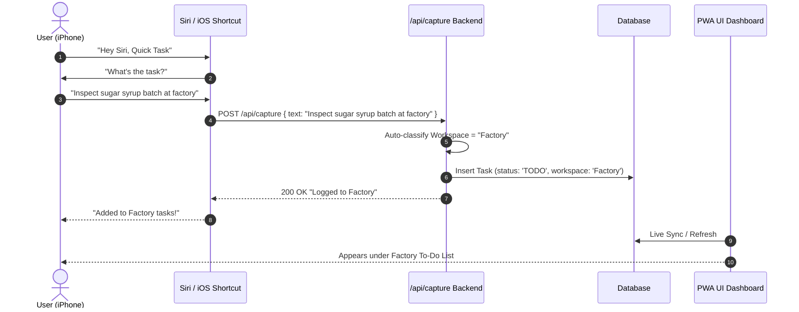

# ADR 0002: iOS Instant Capture Workflow (Siri & Lock Screen Action)

## Status
Accepted

## Context
When someone assigns or mentions a task verbally, the user needs to capture it within 2-3 seconds without unlocking the phone, browsing folders, or navigating complex UI menus.

## Decision
We implement a two-pronged capture architecture:

1. **iOS Siri Shortcut ("Hey Siri, Add Task")**:
   - The user runs an iOS Shortcut via voice: *"Hey Siri, Add Task"*.
   - Siri prompts: *"What's the task?"*
   - User dictates: *"Check bottle capping line in Factory"* or *"Deliver 3D bracket to client"*.
   - The shortcut sends an HTTP POST request with the dictated text and bearer auth token to `/api/capture`.
   - The backend includes a lightweight parser that detects keyword patterns (e.g. "factory", "3d", "print", "jira", "self") and automatically categorizes the workspace and urgency. If no workspace is detected, it lands in the **Inbox** for 1-click triage.

2. **iOS Lock Screen / Action Button Widget**:
   - iOS Shortcut placed on the Action Button (iPhone 15 Pro / 16) or Lock Screen Widget.
   - 1-tap opens a minimal voice/text dictation popup that sends immediately to the backend.

3. **In-App Speed Capture**:
   - Persistent floating `+` button in the PWA with voice recognition web API (dictation directly in browser).

## Architecture Flow

## Consequences
- **Ultra-fast capture**: Under 3 seconds hands-free task creation.
- **Fail-safe fallback**: Any ambiguous tasks land in the global Inbox so nothing is ever lost.
