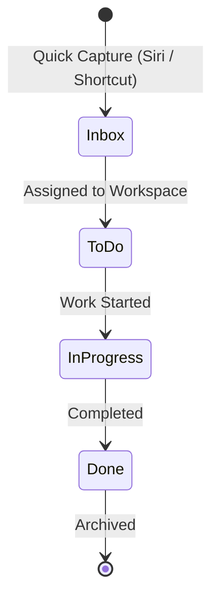

# Domain Glossary

This document defines the core business domains, terminology, and workflows for the Multi-Workspace Task Management System.

---

## 1. Core Domains & Workspaces

### 1.1 Rambagh Office (3D Printing & 3D Scanning)
- **Domain Focus**: Hardware prototyping, scanning operations, 3D print queue, client sample deliveries.
- **Key Concepts**:
  - `Print Job`: Physical 3D printing task with estimated print duration, material type (PLA/PETG/Resin), and status.
  - `Scan Capture`: 3D scanning project (file cleanup, mesh generation, CAD alignment).
  - `Client Deliverable`: Completed physical piece requiring packaging or dispatch.

### 1.2 Beverages Factory
- **Domain Focus**: Daily manufacturing routines, quality control, maintenance, inventory checks, batch dispatch.
- **Key Concepts**:
  - `Daily Routine Checklist`: Repeating operational checklist (e.g. morning sanitization, boiler check, batch logging, shift closing).
  - `Maintenance Task`: Unscheduled or scheduled machine repairs / servicing.
  - `Batch Task`: Specific quality testing or production run milestones.

### 1.3 IT Company Job (Primary tracker: Jira)
- **Domain Focus**: Corporate day-to-day work, sprint backlog sub-tasks, personal focus list.
- **Key Concepts**:
  - `Jira Reference`: Ticket key / summary (e.g., `PROJ-1234`) mirrored into a lightweight local checklist.
  - `Daily Sprint Focus`: Today's top 2-3 focus tickets to unblock PRs or sprint goals.
  - `Meeting Action Item`: Immediate action items noted during standups or meetings.

### 1.4 IT Company Self (Personal Projects & Freelance / Ventures)
- **Domain Focus**: Self-owned tech projects, client freelancing, side startups, personal infrastructure.
- **Key Concepts**:
  - `Feature / Bug Task`: Direct development items.
  - `Urgent Alert / Reminder`: Time-sensitive task with iOS push notifications / alerts.
  - `Backlog vs Done`: Clear visual separation where completed tasks shift to archive/done history.

---

## 2. Universal Entities & Attributes

| Entity | Description | Key Attributes |
| :--- | :--- | :--- |
| **Workspace** | High-level business silo | `id`, `name`, `icon`, `color_theme`, `default_view` (Kanban / Checklist) |
| **Task** | Actionable single item | `id`, `workspace_id`, `title`, `description`, `status`, `priority`, `due_date`, `reminder_at`, `is_recurring`, `created_at` |
| **Checklist Item** | Sub-item or recurring checklist row | `id`, `task_id` (or `workspace_id`), `label`, `is_checked`, `reset_frequency` (daily/none) |
| **Quick Capture Input** | Raw incoming capture stream | `source` (Siri / iOS Shortcut / PWA Quick Add), `raw_text`, `parsed_workspace`, `processed` |
| **Alert / Reminder** | Scheduled prompt | `task_id`, `trigger_time`, `channel` (Push Notification / In-App) |

---

## 3. Status Lifecycle

