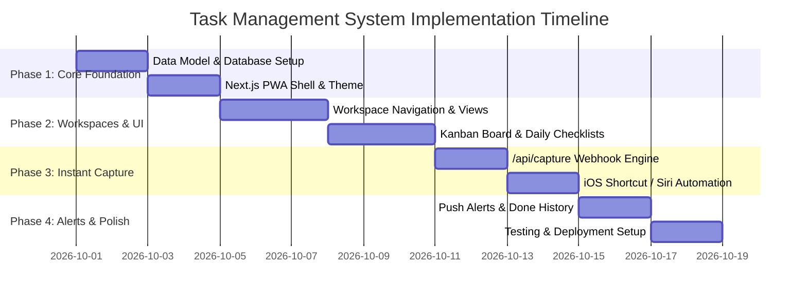

# Project Plan: Multi-Workspace Task Management System (iOS PWA)

## Executive Summary
This project delivers a multi-workspace task tracking and instant-capture application designed specifically for high-mobility use on iPhone (as well as desktop), enabling seamless management across 4 domains:
1. **Rambagh Office**: 3D Printing & 3D Scanning operations.
2. **Beverages Factory**: Daily operational checklists, batch logs, maintenance tasks.
3. **IT Company Job**: Personal Jira-aligned checklist and day focus tracker.
4. **IT Company Self**: Personal projects, startup items, alerts, and Kanban board (To-Do / In Progress / Done).

---

## 1. Feature Specifications

### 1.1 Four Dedicated Workspaces
| Workspace | Primary Views | Special Features |
| :--- | :--- | :--- |
| **Rambagh Office** | Queue View / List | Print duration estimates, material tags, CAD/Scan status |
| **Factory** | Daily Checklist + Kanban | One-tap daily reset checklist (hygiene, machinery, quality), maintenance logs |
| **IT Job** | Today's Focus + Sprint List | Jira Ticket ID link/tag, meeting action items |
| **IT Self** | Full Kanban (To-Do $\rightarrow$ In Progress $\rightarrow$ Done) | Deadline alerts, priority badges, archived done column |

### 1.2 Instant Capture Engine for iPhone
- **Siri Voice Shortcut**: "Hey Siri, Add Task" $\rightarrow$ logs to backend via `/api/capture`.
- **iOS Lock Screen / Home Screen Widget**: 1-tap input for quick typing on the go.
- **Smart Natural Language Routing**: Automatically routes tasks containing keywords (e.g. "print", "factory", "jira", "bot") to the correct workspace; otherwise places them in **Inbox**.

### 1.3 Alerts & Reminder System
- Due dates with time-based alerts.
- Visual badge counters for overdue / today items.
- Web Push notifications directly to iOS Home Screen PWA.

---

## 2. Implementation Roadmap & Phases



### Phase Breakdown

#### **Phase 1: Project Setup & Core Foundation**
- Initialize Next.js 14+ with TypeScript, Tailwind CSS, Lucide Icons, and Prisma/SQLite.
- Configure PWA manifest, service worker, and iOS standalone home-screen support.
- Set up core database schema (`Workspace`, `Task`, `ChecklistItem`, `Reminder`).

#### **Phase 2: Workspaces & Dynamic Views**
- Implement Top Navigation / Bottom Tabs for the 4 Workspaces (`Rambagh`, `Factory`, `IT Job`, `IT Self`, `Inbox`).
- Build **Kanban Board** with drag-and-drop / one-tap status shifting (To-Do, In Progress, Done).
- Build **Daily Routine Checklist** with 1-click "Reset for Tomorrow" for Factory routines.
- Build quick filters: Overdue, Due Today, High Priority.

#### **Phase 3: iPhone Instant Capture & Siri Integration**
- Build `/api/capture` endpoint with token authentication and auto-classification rules.
- Create ready-to-import iOS Shortcut file / iCloud link for:
  - Siri Voice Prompt capture ("Hey Siri, Add Task").
  - Lock Screen Widget tap-to-record.
- Build floating in-app Quick Capture modal with keyboard shortcuts and speech-to-text.

#### **Phase 4: Notifications, Done Archiving & Polish**
- Integrate Web Push Notifications and time-based alert triggers.
- Implement Done task archiving and filtering (so completed tasks don't clutter active views).
- Optimize for smooth touch gestures (swipe left to complete, swipe right to edit).

---

## 3. iOS Shortcut Quick Capture Configuration

```
[iOS Shortcut: "Quick Task"]
  1. Dictate text (or Ask for Input)
  2. Get Dictionary from:
     - text: [Provided Input]
     - client_timestamp: [Current Date]
  3. Get Contents of URL:
     - URL: https://<YOUR_APP_URL>/api/capture
     - Method: POST
     - Headers: Authorization: Bearer <API_KEY>
     - Request Body: JSON { "text": "[Provided Input]" }
  4. Show Notification: "Logged to [Server Response: Workspace Name]"
```

---

## 4. Verification & Testing Criteria
1. **Siri Capture Test**: Speak a task to Siri; verify task is created in under 3 seconds in the correct workspace.
2. **Factory Checklist Test**: Check off daily factory tasks; test daily reset button.
3. **IT Job/Self Kanban Test**: Move tasks between To-Do, In Progress, and Done; verify Done tasks move to the Done section with completion timestamps.
4. **Offline PWA Test**: Launch app in airplane mode on iPhone; verify offline cached view and queued sync.
